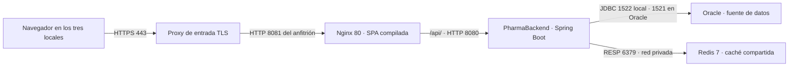

# PharmaSoft — práctica LP II, sesión 7

**Autor:** Miguel Ángel Tinoco López

**Proyecto:** `pharma-frontend`

**Rama:** `feature/spa-categorias-tinoco`

SPA Angular para administrar categorías usando el backend Spring Boot del proyecto Practica.

## Ejecutar

Abre esta carpeta en Visual Studio Code. En su terminal:

```powershell
npm.cmd install
npm.cmd run build
npm.cmd start
```

Abre http://localhost:4200. Usa Angular Language Service como extensión de VS Code (`Angular.ng-template`).

Antes de probar el CRUD, ejecuta el backend original desde IntelliJ. Debe responder en http://localhost:8080/api/v1/categorias y permitir CORS desde http://localhost:4200.
La base Oracle del backend está configurada en localhost:1522/FREEPDB1. El frontend no contiene credenciales.

## Arquitectura

| Carpeta | Responsabilidad |
|---|---|
| core/config | Menú centralizado |
| core/models y core/utils | Contrato y mensajes de error HTTP |
| shared/pages | Página 404 |
| layout | Encabezado, menú lateral y contenedor de rutas |
| features/inicio | Página inicial |
| features/categorias/models | Contratos de entrada y salida |
| features/categorias/services | Cinco operaciones HTTP |
| features/categorias/pages | Listado y formulario reactivo |
| environments | URL de la API |

El servicio concentra las peticiones; los componentes gestionan la vista con signals.
El filtro usa computed y no vuelve a consultar la API.
La misma página permite crear y editar. El parámetro id llega mediante withComponentInputBinding.
Las validaciones coinciden con el DTO: nombre obligatorio de 3 a 50 caracteres, descripción opcional hasta 200 y estado booleano.

## Rutas

- `/inicio`: página principal.
- `/categorias`: listado.
- `/categorias/nuevo`: registro.
- `/categorias/:id/editar`: edición.
- Cualquier otra ruta: página 404.

## Verificación pendiente

Se revisó el contrato del backend original y la sintaxis TypeScript.
La instalación npm quedó bloqueada por la restricción de red del entorno de trabajo: EACCES al conectar a registry.npmjs.org.
**La compilación Angular y las pruebas del navegador todavía no se han ejecutado.**
No se han creado capturas ficticias ni un PDF que afirme pruebas no realizadas.

La copia original del backend no se renombró ni se modificó. Su nombre Practica no impide consumir la API.

## Diferencias del backend respecto de la guía

- CORS ya autoriza localhost:4200.
- Registra categorías duplicadas con respuesta 409.
- El método de actualización no comprueba nombres duplicados.
- El método de eliminación no comprueba productos relacionados ni convierte esa situación explícitamente en error 409.
- Usa Hibernate ddl-auto update; no tiene las migraciones Flyway descritas en la guía.

Para la prueba 8 se necesita el backend actualizado del docente o corregir esa regla de negocio. El frontend presenta los mensajes que devuelve el servidor, pero no puede cambiar los códigos HTTP del backend.

## Evidencias requeridas

Guarda una captura de cada prueba en el orden siguiente, con la pestaña Red cuando corresponda:

| N.º | Prueba | Resultado esperado |
|---|---|---|
| 1 | Abrir localhost:4200 | Redirige a Inicio; opción activa |
| 2 | Abrir Categorías | Datos de Swagger, GET 200 |
| 3 | Buscar por parte del nombre | Filtra sin nuevas peticiones |
| 4 | Registrar nombre An | Validación local; no envía petición |
| 5 | Registrar nombre existente | POST 409 y mensaje del backend |
| 6 | Registrar categoría válida | POST 201 y nueva fila |
| 7 | Editar y desactivar | PUT 200; estado Inactivo |
| 8 | Eliminar categoría con productos | DELETE 409; requiere backend actualizado |
| 9 | Eliminar categoría sin productos | DELETE 204 y fila eliminada |
| 10 | Apagar backend y recargar | Mensaje de falta de conexión |
| 11 | Abrir /xyz | Página 404 |
| 12 | Pulsar ☰ | Oculta y muestra sidebar sin recarga |

Documento final: `Tinoco_LP2_S7_Practica.pdf`.
El módulo Clientes corresponde al reto autónomo; no forma parte de esta implementación de Categorías.

## Publicar el repositorio cuando esté verificado

El repositorio local ya contiene main, develop y la rama de funcionalidad, con commits por cada etapa.
Todavía no tiene remoto ni se ha publicado en GitHub.
Crea un repositorio vacío llamado pharma-frontend y configura:

```powershell
git remote add origin https://github.com/7inox/pharma-frontend.git
git push -u origin main
git push -u origin develop
git push -u origin feature/spa-categorias-tinoco
```

## Despliegue en producción

### Arquitectura y puertos



El proxy TLS representa la instalación propuesta. En la práctica local, Chrome accede a
Nginx por `127.0.0.1:8081`. Los tres locales deben apuntar al mismo servicio central.
Actuator está en el backend y el proxy local reenvía solamente `/api/`.

### Variables de entorno

| Variable | Propósito |
| --- | --- |
| `SPRING_PROFILES_ACTIVE` | Seleccionar el perfil de producción. |
| `DB_URL`, `DB_USERNAME`, `DB_PASSWORD` | Dirección JDBC y cuenta Oracle con privilegios de la aplicación. |
| `JWT_SECRET` | Clave de firma en Base64, de al menos 32 bytes al decodificar. |
| `JWT_EXPIRACION_MINUTOS` | Duración de la sesión JWT. |
| `REDIS_HOST`, `REDIS_PORT` | Conexión al Redis compartido. El backend local usa loopback. |
| `SERVER_PORT` | Puerto del backend. Si se cambia, ajustar también el proxy de Nginx. |
| `CORS_ORIGINS` | Orígenes autorizados si se usa acceso cruzado. La SPA de producción usa el mismo origen. |

### Construcción, publicación y reversión

1. Guardar las referencias Git de ambos componentes y la versión de la configuración
   que se va a publicar. Asegurar un respaldo de Oracle comprobado y aprovisionar el
   esquema. El perfil de producción valida la estructura.
2. En el frontend, ejecutar `npm ci` y `npm run build`. En el backend, cargar las variables
   y ejecutar `./mvnw clean package` o `.\mvnw.cmd clean package`.
3. En el frontend, ejecutar `docker compose -f deploy/docker-compose.yml up -d`.
   Arrancar el JAR en el puerto 8080 y verificar Redis con `redis-cli ping`,
   Nginx con `docker compose ps` y el backend con `/actuator/health/readiness`.
   Comprobar login, recarga en /productos, una lectura del catálogo y métricas con un usuario autorizado.
4. Al publicar el frontend, copiar primero los JS/CSS nuevos con hash y reemplazar
   `index.html` al final. Mantener los archivos de la versión anterior mientras existan
   sesiones que puedan solicitar sus chunks. Conservar JAR y configuración anteriores.
5. Para revertir, restaurar el índice del frontend previo y el JAR/configuración previos.
   Revisar que el esquema sea compatible antes de arrancar. Invalidar las cachés de catálogo
   si cambió el formato serializado. Repetir health y las pruebas de humo.

### Estado de las buenas prácticas

| Buena práctica | Estado | Acción pendiente |
| --- | --- | --- |
| Secretos Oracle y JWT por entorno | Cumple | Configurar el gestor de secretos de la instalación. |
| Oracle en `validate` y migraciones versionadas | Parcial | Incorporar y probar Flyway sobre una copia del esquema. |
| Swagger y SQL de diagnóstico apagados en prod | Cumple | Verificarlo en cada liberación. |
| API y SPA del mismo origen | Cumple | Mantener el proxy y restringir los orígenes externos si se habilitan. |
| TLS para los tres locales | Pendiente | Terminar TLS en el proxy de entrada y renovar el certificado. |
| Budgets y nombres con hash | Cumple | Ejecutar el build de producción en la revisión de cambios. |
| HTML revalidable, estáticos con vigencia larga y API no-store | Cumple | Conservar los activos de la versión anterior durante el cambio. |
| Salud de Nginx, Redis y backend | Parcial | Conectar sondas a alertas y controlar latencia desde cada local. |
| Logs rotativos y código de seguimiento | Cumple | Centralizar el acceso restringido y acordar retención. |
| Versiones y reversión | Parcial | Etiquetar cada versión aprobada y ensayar la reversión de ambos componentes. |

### Prioridades para los tres locales

1. **Proteger el acceso.** Publicar un solo dominio HTTPS y limitar Oracle, Redis y las
   métricas administrativas a la red privada.
2. **Asegurar la recuperación de ventas.** Respaldar Oracle, medir el tiempo de recuperación
   y ensayar la restauración en un entorno aislado. Redis debe ser compartido por todas
   las instancias del backend para que la invalidación de stock sea común.
3. **Detectar incidentes desde los locales.** Medir disponibilidad y latencia por local.
   Alertar por readiness, errores HTTP y Redis caído. Usar el código de seguimiento para
   correlacionar cada incidencia con los logs.
